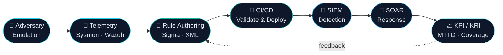

<!-- ═══════════════════════════ HEADER ═══════════════════════════ -->
<div align="center">


<a href="https://github.com/akram-zerbane">
  
</a>

<br/>


<br/>

<a href="https://www.linkedin.com/in/YOUR-LINKEDIN-USERNAME">
  
</a>
<a href="https://github.com/akram-zerbane?tab=repositories">
  
</a>

</div>

<br/>

<!-- ═══════════════════════════ ABOUT ═══════════════════════════ -->

## `> whoami`

```console
akram@soc:~$ cat profile.txt

 Role       : 5th-year Engineering Student — Intelligent Networks & Cybersecurity (ENSA Khouribga)
 Specialty  : Defensive Security · SOC · Detection Engineering
 Interests  : Threat Hunting · Alert Analysis · SIEM · Incident Response · DFIR
 Building   : Detection-as-Code pipelines, SOAR automation, AI-assisted Sigma rule synthesis
 Seeking    : Final-year internship (PFE) starting in February, within a SOC team
```

I design and automate the **full lifecycle of detection use cases**, from adversary emulation and telemetry analysis to rule validation, CI/CD deployment, and KPI-driven governance.

<br/>

<!-- ═══════════════════════════ FOCUS AREAS ═══════════════════════════ -->

## `> focus_areas`

<table>
<tr>
<td width="25%" align="center">

### 🛡️
**Detection Engineering**<br/>
<sub>Sigma / Wazuh rules<br/>MITRE ATT&CK mapping<br/>Detection-as-Code</sub>

</td>
<td width="25%" align="center">

### 🔎
**Threat Hunting & DFIR**<br/>
<sub>Sysmon telemetry<br/>LOLBins analysis<br/>Artifact forensics</sub>

</td>
<td width="25%" align="center">

### ⚙️
**SOAR & Automation**<br/>
<sub>Shuffle playbooks<br/>Ansible remediation<br/>GitLab CI/CD</sub>

</td>
<td width="25%" align="center">

### 📊
**SOC Metrics & Governance**<br/>
<sub>MTTD · Lead Time<br/>KPI / KRI dashboards<br/>Use Case Factory</sub>

</td>
</tr>
</table>

<br/>

<!-- ═══════════════════════════ LIFECYCLE ═══════════════════════════ -->

## `> detection_lifecycle`



<br/>

<!-- ═══════════════════════════ FEATURED PROJECTS ═══════════════════════════ -->

## `> featured_projects`

<table>
<tr>
<td width="50%" valign="top">

#### 🔁 Continuous Assessment & SOC Lifecycle Management
`Detection as Code`

- OpenProject ticketing + GitLab CI/CD: syntax validation, SSH deployment of Wazuh XML rules, remote **Atomic Red Team** execution
- Python **ETL engine** correlating tickets, commits and Wazuh/Sysmon alerts to compute **MTTD** and **Lead Time**
- PostgreSQL + **Grafana** dashboards for governance KPI/KRI and detection coverage


</td>
<td width="50%" valign="top">

#### 🤖 Autonomous AI Agent for Sigma Rule Synthesis
`Detection Engineering × LLM`

- Adversary emulation with **CALDERA** → Sysmon telemetry into **Elasticsearch**
- **Shuffle SOAR** pipeline sanitizing attack artifacts into JSON
- **FastAPI + Groq LLM** agent generating MITRE ATT&CK-mapped Sigma rules, shipped through GitLab CI/CD


</td>
</tr>
<tr>
<td width="50%" valign="top">

#### 🏗️ SOC Architecture & Distributed SIEM Platform
`Infrastructure × SOAR`

- Isolated SOC architecture behind **pfSense**, agents (Sysmon, Auditd, Wazuh) deployed with **Ansible**
- Full-stack dashboard (**FastAPI / React**) for alert mapping and MTTD tracking
- Automated incident response with **Shuffle** and remediation Ansible playbooks


</td>
<td width="50%" valign="top">

#### 🧬 LOLBins Attack Simulation & DFIR Investigation
`Forensics × Detection`

- Reproduction of attacks using native Windows binaries (**LOLBins**)
- Forensic analysis of **Sysmon** telemetry
- Custom **Sigma / Wazuh** detections validated and mapped to MITRE ATT&CK


</td>
</tr>
</table>

<br/>

<!-- ═══════════════════════════ PINNED REPOS ═══════════════════════════ -->

## `> repositories`

<div align="center">

<a href="https://github.com/akram-zerbane/automated-incident-response-pipeline">
  
</a>
<a href="https://github.com/akram-zerbane/agent-dac">
  
</a>
<a href="https://github.com/akram-zerbane/incident-response-ransomware-analysis">
  
</a>
<a href="https://github.com/akram-zerbane/Use-Case-Validation-Framework">
  
</a>

</div>

<br/>

<!-- ═══════════════════════════ TECH STACK ═══════════════════════════ -->

## `> tech_stack`

<div align="center">

**SOC & Threat Intelligence**


**Networks, Cloud & DevOps**


**Development & Data**


</div>

<br/>

<!-- ═══════════════════════════ EXPERIENCE ═══════════════════════════ -->

## `> experience`

| Period | Role | Highlights |
|:--|:--|:--|
| **Jul – Aug 2026** | **Cybersecurity & SOC Intern** — Eurafric Information | Designed a structured **Use Case Factory** for SOC detection lifecycle management; mapped business processes and cross-functional roles (CTI · SIRT · SOC Engineering); defined **KPI/KRI** and deployed a monitoring dashboard |
| **Jul 2025** | **Introductory Intern** — CAPVALUE | Web application vulnerability analysis (**OWASP Top 10**), exploitation of **IDOR / BOLA** flaws |

<br/>

<!-- ═══════════════════════════ CERTIFICATIONS ═══════════════════════════ -->

## `> certifications`

<div align="center">


<br/>


</div>

<br/>

<!-- ═══════════════════════════ GITHUB STATS ═══════════════════════════ -->

## `> github_analytics`

<div align="center">


<br/>


<br/><br/>


</div>

<br/>

<!-- ═══════════════════════════ SNAKE ═══════════════════════════ -->
<!-- Requires the workflow in .github/workflows/snake.yml (provided separately) -->

<div align="center">

<picture>
  <source media="(prefers-color-scheme: dark)" srcset="https://raw.githubusercontent.com/akram-zerbane/akram-zerbane/output/github-snake-dark.svg" />
  <source media="(prefers-color-scheme: light)" srcset="https://raw.githubusercontent.com/akram-zerbane/akram-zerbane/output/github-snake.svg" />
  
</picture>

</div>

<br/>

<!-- ═══════════════════════════ CONTACT ═══════════════════════════ -->

## `> let's_connect`

<div align="center">

Currently looking for a **final-year engineering internship (PFE) starting in February** within a **SOC**: threat hunting, alert analysis, SIEM and incident response.

<br/>

<a href="https://www.linkedin.com/in/YOUR-LINKEDIN-USERNAME">
  
</a>

<br/><br/>


</div>
